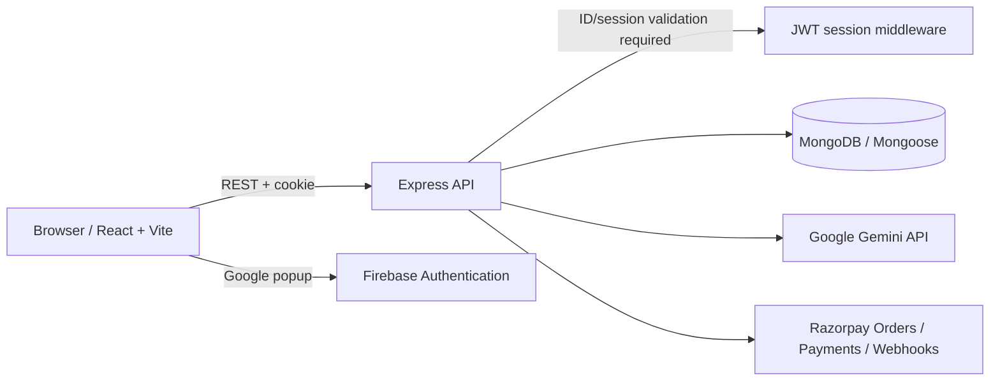

# Product Requirements Document (PRD)

## ConTex.ai — AI Website Builder

| Field | Value |
|---|---|
| Product | ConTex.ai (repository: AI-Website-Builder) |
| Repository | https://github.com/meraj-its-official/AI-Website-Builder |
| Live Link | https://ai-website-builder-1-6f2j.onrender.com |
| Document version | 1.1 — current-source refresh |
| Prepared | October 19, 2026 |
| Owner | Product / Engineering owner to be assigned |
| Status | Draft for review |

> **Document convention:** “Current” describes behavior visible in the inspected source. “Required” describes a product requirement or proposed improvement. A UI element or API route is not considered production-ready solely because code for it exists.

## 1. Executive summary

ConTex.ai is a web application intended to help non-specialists and developers turn a natural-language description into a complete, responsive website. Users generate a standalone HTML document with AI, preview it in the browser, iterate through natural-language instructions, and manage saved projects from a dashboard. The project also includes credit-based plans and a Razorpay checkout flow.

The current implementation contains the principal generation loop: a React client sends a prompt to an Express server; the server calls Google Gemini 3.8 Flash through `server/config/openRouter.js`, parses the JSON response, stores generated HTML and conversation history in MongoDB, and returns a project ID. The editor loads the stored code and provides a preview, an HTML editor, and prompt-based edits.

The next product milestone should be **a reliable, secure MVP**, not a broad expansion of features. Key prerequisites include correcting API URL configuration, completing public publishing, verifying authentication on the server, making billing idempotent, persisting manual edits, and adding automated tests and operational safeguards.

## 2. Problem statement

Creating a polished website requires design decisions, HTML/CSS/JavaScript knowledge, iterative feedback, and time. Users who have a clear idea but limited frontend experience need a way to generate a useful first draft and refine it without repeatedly starting from scratch.

### Product opportunity

Provide one simple workflow that combines:

1. A natural-language brief.
2. AI-generated single-file HTML.
3. Immediate preview.
4. Conversational iteration.
5. Persistent project storage.
6. An understandable usage/credit model.
7. A clear path to export or publish a finished site.

## 3. Product vision and positioning

**Vision:** Make it straightforward to go from an idea to an editable, previewable website draft with AI assistance.

**Product promise:** “Describe it. Generate it. Preview it. Refine it.”

### Differentiators to validate

- Prompt-led creation without requiring a frontend framework in the generated artifact.
- A single-file HTML output that is portable and easy to inspect.
- A visual preview paired with code and conversational changes.
- A clear credit-based usage model.

These differentiators should be validated through user testing; they are positioning hypotheses, not established market research findings.

## 4. Goals, non-goals, and success measures

### 4.1 Goals

- **G1 — Create:** Users can generate a usable first-draft website from a natural-language prompt.
- **G2 — Refine:** Users can improve a generated site without losing the saved project or conversation.
- **G3 — Inspect:** Users can view generated HTML and preview output in a controlled environment.
- **G4 — Manage:** Users can find their saved websites and return to editing them.
- **G5 — Monetize safely:** Credit deductions and payment processing are correct, auditable, and resistant to duplicate events.
- **G6 — Release reliably:** Setup, authentication, failure handling, and deployment behavior are documented and testable.

### 4.2 Non-goals for the first reliable MVP

- Native mobile applications.
- Collaborative real-time editing or team workspaces.
- Automatic generation of full-stack applications with arbitrary backend services.
- Guaranteeing that every AI output is production-ready without human review.
- Automated domain purchase, DNS configuration, or enterprise hosting management.
- Supporting multiple model providers in the first reliability release.

### 4.3 Proposed success measures

Instrument these metrics before setting numeric targets. Establish a baseline, then choose targets with the product owner.

| Metric | Definition | Why it matters |
|---|---|---|
| Generation completion rate | Successful website records created / valid generation attempts | Measures core workflow reliability. |
| First-preview success | Generated projects whose preview renders without a captured runtime error | Measures output usability, not just model response. |
| Time to first preview | Median time from prompt submission to preview ready | Measures perceived speed. |
| Iteration success rate | Successful saved AI updates / valid update attempts | Measures refinement workflow. |
| Project return rate | Users who reopen a saved project in a later session | Indicates ongoing value. |
| Credit correctness | Credit ledger balance matches successful, unique generation/payment events | Protects user trust and revenue. |
| Publish success rate | Published projects reachable without authentication / publish attempts | Validates the release/publication journey. |
| Support/error rate | User-visible failures per active user/session | Highlights operational and UX problems. |

Do not log prompts or generated source by default in product analytics. If content-level diagnostics are needed, obtain appropriate consent, redact secrets, and define a retention policy.

## 5. Target users and use cases

### Persona A — First-time website creator

A student, freelancer, creator, or small-business owner who knows what they want to communicate but is not comfortable writing HTML/CSS. They need a simple creation flow, useful defaults, and understandable errors.

**Primary job:** “Help me create a presentable landing page without having to build every section by hand.”

### Persona B — Developer or technical learner

A user who wants to speed up scaffolding, explore generated markup, and retain control over the source.

**Primary job:** “Give me a responsive starting point that I can inspect and refine.”

### Persona C — Freelancer or independent creator

A user who may create multiple lightweight websites and wants to revise briefs, show a preview to a client, and export or publish the result.

**Primary job:** “Help me turn a client brief into a draft quickly and deliver it reliably.”

## 6. User journeys

### 6.1 New website

1. Visitor opens the landing page.
2. Visitor signs in with Google.
3. User opens the generator and writes a website brief.
4. System validates the prompt and confirms sufficient credits.
5. System requests a website from Gemini 3.8 Flash and parses the structured response. A robust schema validation gate is still required before saving.
6. System stores the generated code and initial conversation.
7. Client opens the editor and renders a preview.
8. User reviews the output and requests improvements.

**Desired outcome:** A saved project with visible code, a rendered preview, and a clear explanation for any failure.

### 6.2 Refine an existing website

1. User opens a saved project from the dashboard.
2. The system retrieves the project and its conversation, enforcing ownership.
3. User requests an update in natural language or makes a direct code edit.
4. AI changes are validated and stored only after a successful update.
5. Preview updates to match the saved version.
6. User can undo/recover to a prior version in a future iteration of the product.

**Current gap:** AI updates are stored, but manual Monaco edits do not have a dedicated persistence path and version history/rollback is not implemented.

### 6.3 Purchase credits

1. User selects a paid package.
2. Server creates an order using trusted plan configuration.
3. Checkout completes with Razorpay.
4. Server verifies the payment, binds it to the authenticated user, and records a unique payment event.
5. Credits are added once, even if browser verification and webhook delivery both occur.
6. The user sees updated balance and payment status.

**Current gap:** The checkout and verification paths exist, but a durable payment ledger and idempotency protections need to be added and tested before production use.

### 6.4 Publish/share a website

1. User chooses Publish.
2. Server creates a unique slug for the project.
3. Project becomes publicly readable through a deliberate published-only endpoint.
4. Anonymous visitor opens the public URL and sees the generated website, not the editor or private project metadata.
5. Owner can unpublish or update the project in a later release.

**Current gap:** The route has an implementation bug, and the slug retrieval endpoint currently requires authentication. Public publishing must be completed before being advertised as operational.

## 7. Functional requirements

Priorities: **P0** = release blocker for a reliable MVP; **P1** = important follow-up; **P2** = later enhancement.

### 7.1 Identity and sessions

- **AUTH-01 (P0):** Users can sign in with Google.
  - Acceptance: a valid Firebase ID token is sent to the server and verified server-side before a local session is issued.
- **AUTH-02 (P0):** Authenticated endpoints require a valid, unexpired session.
  - Acceptance: missing, invalid, and expired credentials receive predictable 401/403 responses; private records are not exposed.
- **AUTH-03 (P0):** Users can log out.
  - Acceptance: the session cookie is cleared using matching cookie options and the client returns to a signed-out state.
- **AUTH-04 (P0):** Production cookie and CORS settings are environment-driven.
  - Acceptance: HTTPS production uses secure cookie attributes, and only explicitly configured origins are allowed.

### 7.2 Prompt-to-website generation

- **GEN-01 (P0):** An authenticated user can submit a non-empty prompt.
  - Acceptance: invalid/empty prompts are rejected with a clear 4xx response; the UI prevents duplicate submissions while a request is in progress.
- **GEN-02 (P0):** A valid prompt produces a complete single-file HTML document.
  - Acceptance: output must contain a valid HTML document, and a schema/validation step confirms the expected `{ message, code }` shape before saving.
- **GEN-03 (P0):** The system checks credit balance before calling the model and deducts credits only after a successful save.
  - Acceptance: model/provider or persistence failures do not charge the user; concurrent requests cannot overspend the balance.
- **GEN-04 (P0):** Failures are actionable and do not expose secrets or raw stack traces.
  - Acceptance: timeout, rate-limit, invalid model response, and provider errors map to safe messages and structured server logs.
- **GEN-05 (P1):** The user sees accurate progress states.
  - Acceptance: progress reflects actual server events where possible; the UI does not present a simulated percentage as a measured model completion value. The current progress meter is simulated in the browser and should be labelled as such until server progress is available.
- **GEN-06 (P1):** Users can save or reuse prompt templates.
  - Acceptance: templates are selectable, editable, and do not overwrite user text unexpectedly.

### 7.3 Projects and dashboard

- **PROJ-01 (P0):** Users can list their saved projects.
  - Acceptance: only the current user's projects are returned; loading, empty, and error states render correctly.
- **PROJ-02 (P0):** Users can reopen a project.
  - Acceptance: latest saved code and conversation are loaded from persistent storage and ownership is checked server-side.
- **PROJ-03 (P0):** Users can save manual HTML edits.
  - Acceptance: a save action persists code with ownership validation, success/error feedback, and a dirty-state indicator.
- **PROJ-04 (P1):** Users can view prior versions and restore one.
  - Acceptance: every saved AI/manual update creates a version record with timestamp and origin; restoring creates a new version instead of erasing history.
- **PROJ-05 (P1):** Users can rename and delete projects.
  - Acceptance: mutations require authentication, ownership checks, confirmation for destructive actions, and defined deletion behavior for published URLs.

### 7.4 Editor and preview

- **EDIT-01 (P0):** The editor shows generated source in a readable code editor.
  - Acceptance: content remains available on refresh after an explicit save.
- **EDIT-02 (P0):** Preview updates when source changes.
  - Acceptance: preview reflects the current working version; preview errors do not break editor navigation.
- **EDIT-03 (P0):** Untrusted generated content is isolated from application credentials and origin.
  - Acceptance: security review validates sandbox settings and origin separation; generated HTML cannot access app cookies, storage, or privileged APIs.
- **EDIT-04 (P1):** Users can inspect responsive layouts.
  - Acceptance: dedicated viewport presets are available and preview can be used at mobile, tablet, and desktop widths.
- **EDIT-05 (P1):** Users receive AI update feedback.
  - Acceptance: the conversation displays the request and response in consistent order; failed changes preserve the previous working version and explain what happened.
- **EDIT-06 (P1):** Users can export their website source.
  - Acceptance: user can download the saved HTML as `index.html`; export content matches the chosen saved version.

### 7.5 Publish/share

- **PUB-01 (P0 before public launch):** Owner can publish a saved website through an explicit app-hosted slug route or a selected hosting provider.
  - Acceptance: server returns a valid URL only after storing the published state; errors use standard JSON responses and correct HTTP status codes. The current implementation is only an in-app slug concept and has no confirmed external hosting integration.
- **PUB-02 (P0 before public launch):** A published project is accessible to anonymous viewers.
  - Acceptance: published-only read route returns the HTML document or content needed for rendering; drafts remain private and user details are never included.
- **PUB-03 (P1):** Owner can unpublish or republish an updated version.
  - Acceptance: unpublishing disables public access; republishing atomically updates the published version.
- **PUB-04 (P1):** Slugs are unique, stable, and validated.
  - Acceptance: slug collision is handled explicitly; invalid slugs return 404, not a generic server error.

### 7.6 Credits, plans, and payments

- **BILL-01 (P0):** Credit costs and plan prices are configured on the server.
  - Acceptance: changing the client request cannot alter order amount, plan, or number of credits granted.
- **BILL-02 (P0):** A payment is associated with the authenticated user and a server-created order.
  - Acceptance: server ignores any client-supplied user identity that conflicts with the session.
- **BILL-03 (P0):** A valid payment grants credits exactly once.
  - Acceptance: browser verification and webhook delivery for the same payment do not create duplicate credit grants; invalid/replayed signatures do not change the balance.
- **BILL-04 (P0):** User plan and payment state are represented consistently in the data model.
  - Acceptance: schema, controllers, and UI use the same canonical fields, and database updates are verified by integration tests.
- **BILL-05 (P0):** Users can see their credit balance and a basic transaction history.
  - Acceptance: every credit addition/deduction has a durable ledger entry and reconciles with the displayed balance.
- **BILL-06 (P1):** Payment events are reconciled and actionable.
  - Acceptance: failed or pending payments do not grant credits and can be investigated without exposing payment secrets.

### 7.7 Administration and support

- **OPS-01 (P0):** Operators can determine service health without making a paid AI request.
  - Acceptance: a health endpoint reports service status and dependency checks without leaking credentials.
- **OPS-02 (P0):** Server errors are correlated with request IDs and sanitized logs.
  - Acceptance: no secrets, authentication tokens, raw payment signatures, or sensitive user content are written to logs.
- **OPS-03 (P1):** Basic usage analytics are available.
  - Acceptance: track aggregate workflow metrics defined in Section 4 without collecting prompt/content unnecessarily.

## 8. Business rules

The values below reflect the current source and must be confirmed by the product owner before launch.

| Rule | Current value | Required behavior |
|---|---|---|
| New-user credit balance | 100 credits | Display balance and ledger consistently. |
| Website generation cost | 50 credits | Deduct only after successful generation and persistent save. |
| AI update cost | 25 credits | Deduct only after a valid update is saved. |
| Free package | ₹0 / 100 credits | Define whether credits replenish and under what conditions. |
| Pro package | ₹499 / 700 credits | Confirm it is a one-time purchase rather than a subscription. |
| Enterprise package | ₹1,499 / 3,000 credits | Confirm the plan's “team” wording before offering collaboration that is not currently implemented. |
| Credit expiry | Not defined in inspected source | Product owner must decide and communicate expiry/refund rules. |
| Refund policy | Not defined in inspected source | Must be documented before real payments are enabled. |

The present `User` model has a `plan` field, while billing updates attempt to write `currentPlan` and `lastPaymentStatus`. The product data contract must be normalized before plan and billing state can be considered correct.

## 9. Non-functional requirements

### Security and privacy

- Verify Firebase identity tokens on the server; use authorization checks for every project read and mutation.
- Use HTTPS, secure HTTP-only cookies, an explicit SameSite policy, and environment-specific CORS.
- Keep model, database, JWT, and payment secrets server-side.
- Isolate generated HTML in a separate origin or a rigorously designed sandbox; test scripts, forms, links, and malicious prompt outputs.
- Verify Razorpay webhooks against the exact raw payload and make payment/credit processing idempotent.
- Define data retention and deletion behavior for user accounts, prompts, generated code, and payment records.
- Add rate limiting and limits for prompt length, generated output size, and request concurrency.

### Reliability and performance

- Time-bound model and database operations and return a safe error if an upstream provider fails.
- Retry only appropriate transient errors with bounded retry counts and backoff.
- Avoid holding duplicate generation jobs for repeated clicks; introduce request IDs or idempotency keys where appropriate.
- Keep dashboard navigation responsive while preview and code editor are loaded.
- Set an initial target for generation latency only after measuring real provider latency and output quality.

### Accessibility and usability

- Support keyboard access for all key actions and visible focus indicators.
- Ensure text contrast and responsive layout behavior meet WCAG 2.2 AA goals where applicable.
- Announce errors and generation state changes to assistive technology.
- Provide understandable empty, loading, timeout, insufficient-credit, and payment-failure states.
- Do not imply that a simulated progress value is exact or that generated code is guaranteed production-safe.

### Current UI and delivery gaps

- Generation and edit progress labels are client-side animations, not server-streamed progress. They must not be interpreted as accurate completion percentages or latency estimates.
- The dashboard error state attempts to call the boolean `loading` state as a function, and the editor currently logs AI update failures without a user-facing explanation.
- The pricing UI advertises source downloads, faster generation, team collaboration, and dedicated support; the inspected code does not fully implement these as product capabilities.
- The deploy route is an in-app slug concept, not a connection to a static-site hosting provider. Public anonymous access is incomplete.

### Maintainability

- Use shared request/response contracts and centralized configuration rather than hard-coded URLs.
- Add lint/build/test checks to CI.
- Maintain a documented environment template and production deployment guide.
- Pin and regularly update dependencies; monitor known vulnerabilities.

## 10. Current technical baseline

### Architecture

The frontend is a React 19 SPA built with Vite 8 and Tailwind CSS 4. The server uses Express 5, Mongoose, a server-side Google Gemini API call (`gemini-3.8-flash`), and Razorpay order/payment routes. The active AI code lives in a file named `openRouter.js`, although its OpenRouter implementation is commented out. The user and website schemas persist profile/credit fields and website source/conversation metadata. The client package currently hard-codes its API origin to `https://ai-website-builder-88f9.onrender.com`; the server defaults to port `5000` and allows `https://ai-website-builder-1-6f2j.onrender.com` through CORS.

**Dependency baseline from package manifests:** React/React DOM `^19.2.8`, Vite `^8.3.0`, Tailwind CSS `^4.3.3`, React Router DOM `^7.18.4`, Motion `^14.1.0`, Express `^5.3.0`, Mongoose `^9.11.1`, and Razorpay `^2.9.8`. Vite 8 requires Node.js `20.19+` or `22.12+`; validate the installed runtime against the package requirements before local setup.

### Existing API surface

| Method | Path | Intended behavior | Current notes |
|---|---|---|---|
| POST | `/api/auth/google` | Establish session | Accepts profile attributes from client; Firebase token verification is needed. |
| GET | `/api/auth/logout` | Clear session | Cookie attributes should match those used to set the cookie. |
| GET | `/api/user/me` | Current user | Protected by JWT cookie middleware. |
| POST | `/api/website/generate` | Create website | Protected; 50-credit deduction in current controller. |
| POST | `/api/website/update/:id` | Update existing website | Protected and owner-scoped; 25-credit deduction. |
| GET | `/api/website/get-by-id/:id` | Get project | Protected and owner-scoped. |
| GET | `/api/website/get-all-items` | List user's projects | Protected and user-scoped. |
| GET | `/api/website/deploy/:id` | Publish project | Current response implementation is defective and must be fixed. |
| GET | `/api/website/get-by-slug/:slug` | Resolve published project | Currently protected, so it does not meet anonymous public-page requirements. |
| POST | `/api/payment/orders` | Create Razorpay order | Must bind order to session identity and server-owned plan configuration. |
| POST | `/api/payment/verify` | Verify payment | Must record payment and credit grant idempotently. |
| POST | `/api/payment/razorpay/webhook` | Process payment event | Exact raw-body verification and deduplication need validation. |

**Payment code findings:** orders currently accept `userId` from the request body instead of deriving identity solely from `req.user`; verification and `payment.captured` webhook handling both increment credits without an idempotency record; the `User` schema has `plan`, while the billing controller writes `currentPlan` and `lastPaymentStatus`; and app-level `express.json()` is installed before the webhook route's `express.raw()` middleware. These paths are not production-ready until corrected and tested.

### Data entities

**User (current fields):** `name`, `email`, `avatar`, `credits`, `plan`, timestamps.

**Website (current fields):** `user`, `title`, `latestCode`, `conversation[]` (role/content/timestamps), `deployed`, `deployedUrl`, `slug`, timestamps.

**Recommended future entities:**

- `WebsiteVersion`: website ID, version number, code, source (`ai` / `manual` / `restore`), prompt summary, created timestamp.
- `Payment`: user ID, Razorpay order/payment IDs, plan key, amount, currency, status, signature-verification result, timestamps, idempotency key.
- `CreditLedgerEntry`: user ID, delta, reason, related generation/payment/version ID, balance after transaction, timestamp.

Keep the `User.credits` balance as a cached aggregate only if every change is transactionally reconciled with the ledger.

## 11. Known release blockers and technical decisions

### Release blockers (P0)

1. **Port and environment configuration:** client hard-codes port 8000 while the server default is 5000. Move to `VITE_API_BASE_URL` and configurable CORS.
2. **Public publishing:** fix the invalid deploy response, implement public-only slug retrieval, and guarantee that draft project data remains private.
3. **Auth trust boundary:** verify Firebase ID tokens server-side; do not issue a trusted app session based solely on user-supplied email/name/avatar fields.
4. **Payment consistency:** reconcile `plan` vs `currentPlan`, validate order ownership/amount, make verification/webhook handlers idempotent, and add a credit ledger.
5. **Credit concurrency:** prevent concurrent generation/update requests from spending the same credits more than once.
6. **Preview isolation:** assess the sandbox configuration and isolate generated scripts from the app origin, cookies, and user session.
7. **Persist direct edits:** implement saving of Monaco editor content or label the editor as a temporary scratchpad until save is available.
8. **Automated tests:** add API, auth, ownership, generation, payment, and publishing tests before production release.
9. **Webhook raw-body handling:** configure Razorpay webhook processing before the global JSON parser, or otherwise preserve the original bytes, and test signature verification against real fixtures.
10. **Frontend reliability:** fix dashboard error-state rendering, make AI update failures visible, and prevent duplicate/empty prompt submissions.
11. **Feature/marketing alignment:** remove or implement pricing-page promises such as source download, fast generation, team collaboration, and dedicated support.

### Important pre-release tasks (P1)

- Add source download/export.
- Add project rename/delete and version history/rollback.
- Create `.env.example` files with placeholders and a production deployment guide.
- Add validation and normalized error handling across endpoints.
- Add monitoring, health checks, request IDs, and usage metrics.
- Add a license and define commercial/open-source reuse terms.

## 12. Roadmap proposal

### Milestone 0 — Stabilize current MVP (P0)

- Centralize API and CORS configuration.
- Harden Firebase session creation.
- Fix publishing endpoint and add public-only site resolver.
- Correct plan field mapping, ownership checks, payment idempotency, webhook signature verification, and credit accounting.
- Persist direct edits and add safe preview isolation.
- Add smoke/integration tests and environment templates.

**Exit criteria:** A new user can authenticate; create, reload, edit, and save a website; consume credits correctly; and publish a site that works in a private/incognito window. Invalid sessions and duplicate payment events do not disclose data or alter balances incorrectly.

### Milestone 1 — Useful creator workflow (P1)

- HTML export/download.
- Version history and restore.
- Project rename/delete.
- Responsive preview presets and accessible progress/error states.
- Prompt templates and better generated-output validation.

**Exit criteria:** Users can download the exact saved version, recover from a bad edit, and understand usage and error states.

### Milestone 2 — Growth and collaboration (P2)

- Optional template gallery and reusable brand/style presets.
- Team workspaces and shared projects.
- Usage analytics and credit transaction history UI.
- Additional model provider configuration only after reliability/cost evaluation.

**Exit criteria:** Each feature is supported by measured user demand, clear authorization boundaries, and operational cost estimates.

## 13. Acceptance checklist for an MVP release

- [ ] A signed-in user can generate a site with a valid prompt.
- [ ] Empty prompts, invalid AI output, provider timeouts, and insufficient credits produce controlled errors.
- [ ] Credits are charged only after a successfully saved generation/update.
- [ ] A user cannot read or edit another user's private project by changing an ID.
- [ ] A user can manually edit, explicitly save, reload, and see the same code.
- [ ] Preview output is isolated from application credentials and origin.
- [ ] Anonymous visitors can open a published link; unpublished projects remain private.
- [ ] A valid Razorpay payment grants the correct credits once; failed/forged/replayed events grant none.
- [ ] Production configuration uses HTTPS, secure cookies, controlled CORS, and server-only secrets.
- [ ] `npm run build` and `npm run lint` pass in the client.
- [ ] Dashboard and editor error paths show actionable user-facing errors.
- [ ] Razorpay webhook signature verification uses the original raw payload and succeeds against valid fixtures while rejecting altered payloads.
- [ ] Automated server tests cover auth, ownership, credits, AI failures, payment verification, webhooks, and public publishing.
- [ ] README, environment templates, API contracts, license, and deployment instructions are up to date.

## 14. Open product decisions

The owner/product lead should decide these before a public launch:

1. Are Pro and Enterprise intended as one-time credit purchases or recurring subscriptions?
2. Do unused credits expire? Can credit purchases be refunded?
3. Should published sites be hosted on the app domain, a dedicated hosting provider, or downloadable by default?
4. Should projects or prompts be retained indefinitely, and how can a user delete their data?
5. What is the initial target audience: learners, freelancers, small businesses, or all three?
6. What is the acceptable generation latency and cost per successful site?
7. Which browsers and minimum viewport widths are officially supported?
8. Which open-source license and contribution policy should apply?

## 15. Assumptions and constraints

- This PRD is based on the public source files and package manifests visible on the repository's `main` branch on October 19, 2026; a local build and runtime test were not performed as part of the documentation review.
- Current plan prices, credit costs, endpoint names, and technology choices are taken from the inspected source and may need owner confirmation.
- AI output is probabilistic and must be validated and previewed; the product cannot guarantee production quality from prompt text alone.
- This PRD treats public publishing, robust payments, production authentication, export, and manual edit persistence as incomplete until the release criteria above are met.

---

**Related document:** [`README.md`](./README.md) for repository setup, environment variables, feature status, and current API paths.
