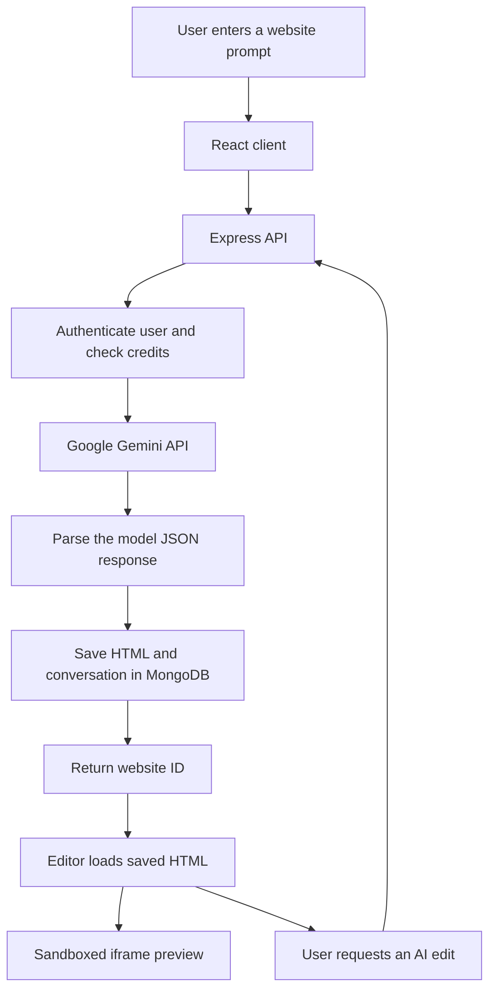

# ConTex.ai — AI Website Builder

> Turn a natural-language website idea into a single-file HTML website, preview it, and refine it with AI.

**Repository:** [meraj-its-official/AI-Website-Builder](https://github.com/meraj-its-official/AI-Website-Builder) 
**Live Link:** [Build Website Powered by Ai](https://ai-website-builder-1-6f2j.onrender.com)
**Product name in the UI:** ConTex.ai  
**Project type:** Full-stack AI web application  
**Documentation status:** Refreshed against the public `main` branch on October 19, 2026.

ConTex.ai is an AI-assisted website-building project. A user describes the website they want, the server asks Google Gemini to generate a complete HTML document, and the generated document is saved to MongoDB. Users can revisit saved projects, request changes in natural language, inspect the HTML in Monaco Editor, and preview the result in an iframe.

> **Project status:** This README describes the current implementation, not a claim that every UI path is production-ready. The current source contains known integration and publishing gaps; review [Known limitations and production checklist](#known-limitations-and-production-checklist) before deploying it publicly.

## Contents

- [Features](#features)
- [How it works](#how-it-works)
- [Technology stack](#technology-stack)
- [Repository structure](#repository-structure)
- [Prerequisites](#prerequisites)
- [Local setup](#local-setup)
- [Environment variables](#environment-variables)
- [Using the application](#using-the-application)
- [API reference](#api-reference)
- [Credit and pricing model](#credit-and-pricing-model)
- [Build and lint](#build-and-lint)
- [Security notes](#security-notes)
- [Known limitations and production checklist](#known-limitations-and-production-checklist)
- [Contributing](#contributing)
- [License](#license)
- [Product requirements](#product-requirements)

## Features

| Capability | Current status | Details |
|---|---|---|
| Prompt-to-website generation | Implemented | Sends a text prompt to Gemini and requests a complete HTML document with inline CSS and JavaScript. |
| Responsive website instructions | Implemented in the generation prompt | The prompt asks the model for mobile, tablet, and desktop layouts; generated output still needs to be reviewed and tested. |
| Google sign-in UI | Partially implemented | Firebase Google sign-in is used in the client and a backend endpoint creates a session cookie. The backend currently does not verify a Firebase ID token. |
| Saved projects and dashboard | Implemented | Website code, title, conversation, and metadata are stored in MongoDB. |
| Prompt-based iteration | Implemented | Users can ask the AI to update the saved website; the app stores the returned code and conversation and deducts credits. |
| Live preview | Implemented | Generated HTML is previewed in an iframe. Review the security note below before handling untrusted content. |
| HTML editor | Implemented | Monaco Editor displays and locally edits the generated HTML. Manual edits are not currently persisted by a dedicated save action. |
| Credit-based plans | Present; verify before launch | The UI and backend define Free, Pro, and Enterprise credit packages. Payment/credit consistency needs additional work. |
| Razorpay checkout | Present; verify before launch | Backend order creation and signature verification exist. Payment identity binding and duplicate-credit handling need hardening. |
| Public publishing/share links | Incomplete | The app has a slug-based in-app route, not an external hosting integration. The deploy handler has a response bug, and slug lookup requires authentication and project ownership. |
| Source download/export | Not implemented in the inspected editor | The pricing UI mentions downloading source code, but no export/download action was found in the editor component inspected. |

## How it works



The generated artifact is intended to be **one standalone HTML file** containing its CSS and JavaScript. The backend generation prompt asks the model to avoid frontend frameworks and external CSS/JS dependencies, and to return JSON containing a confirmation message and the HTML source.

## Technology stack

### Client

- React 19 and React DOM
- Vite
- Tailwind CSS 4 with the Vite plugin
- React Router
- Redux Toolkit and React Redux
- Axios for API requests
- Firebase Authentication (Google sign-in)
- Monaco Editor for HTML editing
- Motion for UI animation
- Lucide React icons

### Server

- Node.js with ES modules
- Express 5
- MongoDB with Mongoose
- Google Gemini API through a server-side `fetch` integration (`gemini-3.8-flash`)
- JWT session token in an HTTP-only cookie
- Razorpay for one-time plan/credit purchases
- `dotenv`, `cors`, and `cookie-parser`

### Current package baseline

The repository's `package.json` files currently specify these dependency ranges (the lockfiles, where present, determine the exact installed versions):

| Area | Current dependency ranges / versions |
|---|---|
| Client runtime | React / React DOM `^19.2.8`; React Router DOM `^7.18.4` |
| Client tooling | Vite `^8.3.0`; `@vitejs/plugin-react` `^6.1.1`; Tailwind CSS `^4.3.3`; `@tailwindcss/vite` `^4.3.3` |
| Client state / UI | Redux Toolkit `^2.13.0`; React Redux `^9.3.0`; Motion `^14.1.0`; Lucide React `^1.59.0`; Monaco Editor React `^4.8.0-rc.3` |
| Client integrations | Firebase `^13.0.0`; Axios `^1.20.0` |
| Server runtime | Express `^5.3.0`; Mongoose `^9.11.1`; `jsonwebtoken` `^9.0.3` |
| Server integrations | Razorpay `^2.9.8`; CORS `^2.8.6`; `cookie-parser` `^1.4.7`; `dotenv` `^18.0.8`; Nodemon `^3.1.14`; `crypto` `^1.0.1` (the controller should prefer Node’s built-in `node:crypto`) |

**AI provider note:** The active implementation is in `server/config/openRouter.js`, but it currently calls the Google Gemini API using model ID `gemini-3.8-flash`; the older OpenRouter example in that file is commented out. The filename is misleading and can be renamed during cleanup. See the [Gemini API model documentation](https://ai.google.dev/gemini-api/docs/models/gemini-3.8-flash) for the current model contract.

## Repository structure

```text
AI-Website-Builder/
├── client/
│   ├── src/
│   │   ├── authentication/   # Firebase client setup
│   │   ├── components/       # Shared UI and navigation components
│   │   ├── hooks/            # Client hooks
│   │   ├── pages/            # Home, dashboard, generator, editor, pricing
│   │   └── redux/             # Redux store and user state
│   ├── index.html
│   ├── package.json
│   └── vite.config.js
├── server/
│   ├── config/               # MongoDB, Gemini, Razorpay and plan config
│   ├── controllers/          # Auth, user, website and billing logic
│   ├── middlewares/          # JWT authentication middleware
│   ├── models/               # Mongoose user and website schemas
│   ├── routes/               # Express API routers
│   ├── utils/                # AI response parsing utility
│   ├── index.js
│   └── package.json
├── README.md
└── PRD.md
```

## Prerequisites

- Git
- Node.js `20.19+` or `22.12+` and npm (required by the current Vite 8 toolchain)
- A MongoDB database, local or hosted
- A Google Gemini API key
- A Firebase project with Google Authentication enabled
- Razorpay test credentials if you want to test paid credit packages

The current source hard-codes the client API base URL as `https://ai-website-builder-88f9.onrender.com`, while the server defaults to port `5000` and only allows `https://ai-website-builder-1-6f2j.onrender.com` through CORS. For local development, set `PORT=8000` in the server environment. For deployment, replace the hard-coded client URL and CORS origin with environment-driven configuration.

## Local setup

### 1. Clone the repository

```bash
git clone https://github.com/meraj-its-official/AI-Website-Builder.git
cd AI-Website-Builder
```

### 2. Configure and start the server

```bash
cd server
npm install
```

Create `server/.env` using the template in [Environment variables](#environment-variables). Set `PORT=8000` to match the current client API URL. Then start the API:

```bash
npm run dev
```

The server listens on port `https://ai-website-builder-88f9.onrender.com` when configured as above, attempts to connect to MongoDB, and exposes its routes below `/api`. Note that the server currently logs a MongoDB connection error without stopping the process, so a running port does not by itself confirm database readiness.

### 3. Configure and start the client

Open a second terminal from the repository root:

```bash
cd client
npm install
```

Create `client/.env.local` using the client template below, then start Vite:

```bash
npm run dev
```

Open the Live Link via Render: `https://ai-website-builder-1-6f2j.onrender.com`.

### 4. Verify local prerequisites

1. Confirm the server can connect to MongoDB.
2. Confirm the Gemini API key is valid by submitting a small website prompt after signing in.
3. Confirm the Firebase project's Google provider and authorized domain are configured for local development.
4. Use Razorpay **test mode** credentials until checkout and credit accounting have been tested end-to-end.

There is no root-level workspace script; install and run the client and server separately.

## Environment variables

Create these files locally. **Do not commit secrets or real `.env` files.** The repository currently does not provide committed `.env.example` files for both applications.

### `server/.env`

```dotenv
# The client currently points to localhost:8000. Keep this port aligned.
PORT=8000

# MongoDB connection string
MONGODB_URL=mongodb+srv://<username>:<password>@<cluster>/<database>?retryWrites=true&w=majority

# Use a long, random secret; never use this example value in production.
JWT_SECRET=replace-with-a-long-random-secret

# Active server-side AI integration
GOOGLE_GEMINI_API_KEY=your_google_gemini_api_key

# Razorpay server credentials (test keys during local development)
RAZORPAY_API_KEY=rzp_test_your_key_id
RAZORPAY_KEY_SECRET=your_razorpay_key_secret
RAZORPAY_WEBHOOK_SECRET=your_razorpay_webhook_secret

# Spelling follows the current source code variable name.
FRONTEND_URL=https://ai-website-builder-1-6f2j.onrender.com
```

### `client/.env.local`

```dotenv
# Firebase Web API key for the Firebase project configured in src/authentication/firebase.js
VITE_FIREBASE_API_KEY=your_firebase_web_api_key

# Razorpay public key ID; never put the Razorpay key secret in a Vite variable.
VITE_RAZORPAY_API_KEY=rzp_test_your_key_id
```

The Firebase configuration in `client/src/authentication/firebase.js` reads `VITE_FIREBASE_API_KEY` from the environment, but other Firebase project identifiers are currently hard-coded. If you use a different Firebase project, replace those values too, enable Google as a sign-in provider, and add the relevant development/production domains to Firebase Authorized Domains. Prefer moving all Firebase configuration values into environment variables.

Vite exposes variables prefixed with `VITE_` to browser code. Treat them as public configuration, not secrets. Gemini, JWT, MongoDB, and Razorpay secret keys belong only on the server.

The client currently does **not** read an API base URL from Render environment configuration; `client/src/App.jsx` hard-codes `https://ai-website-builder-88f9.onrender.com`. Adding `VITE_API_BASE_URL` requires a code change as well as an environment entry.

## Using the application

1. Open the home page and sign in through Google.
2. Go to the dashboard or website generator.
3. Describe the website you want to create. Be specific about the audience, pages/sections, content, visual direction, and important interactions.
4. Submit the prompt and wait for the server-side Gemini request to finish.
5. Review the website in the live preview. The displayed generation progress is simulated client-side; it is not streamed from the AI provider.
6. Open the code panel to inspect or edit the generated HTML.
7. To ask the AI for a change, describe the change in the editor chat. Examples: “Make the navigation sticky on mobile” or “Add a pricing section with three plans.”
8. Return to the dashboard to view saved website projects.

**Important:** Manual code changes in Monaco currently update the editor/preview state but do not have a dedicated persistence action. Use the prompt-based update flow to persist AI-generated changes, and verify saved code after reloading.

## API reference

All paths are relative to the server origin, for example `https://ai-website-builder-88f9.onrender.com` in the setup above. Authenticated routes use the `token` cookie created by the auth controller.

| Method | Endpoint | Access | Purpose |
|---|---|---|---|
| `POST` | `/api/auth/google` | Public endpoint | Creates/finds a user and issues the session cookie based on the submitted profile fields. See the security warning below. |
| `GET` | `/api/auth/logout` | Public endpoint | Clears the session cookie. |
| `GET` | `/api/user/me` | Authenticated | Returns the current user. |
| `POST` | `/api/website/generate` | Authenticated | Generates a website; currently deducts 50 credits. Body: `{ "prompt": "..." }`. |
| `POST` | `/api/website/update/:id` | Authenticated | Updates a saved website with an AI prompt; currently deducts 25 credits. Body: `{ "prompt": "..." }`. |
| `GET` | `/api/website/get-by-id/:id` | Authenticated | Fetches one website owned by the current user. |
| `GET` | `/api/website/get-all-items` | Authenticated | Lists websites owned by the current user. |
| `GET` | `/api/website/deploy/:id` | Authenticated | Sets deployment/slug metadata and attempts to return an in-app `/site/:slug` URL. The handler has a response bug, and this is not an external hosting deployment. |
| `GET` | `/api/website/get-by-slug/:slug` | Authenticated in current code | Fetches a slug only when it belongs to the signed-in user. It cannot serve a public share link to an anonymous visitor yet. |
| `POST` | `/api/payment/orders` | Authenticated | Creates a Razorpay order for a paid plan. |
| `POST` | `/api/payment/verify` | Authenticated | Verifies the Razorpay payment signature and applies credits. Needs identity and idempotency hardening. |
| `POST` | `/api/payment/razorpay/webhook` | Webhook signature intended | Razorpay webhook handler for payment events. Confirm raw-body signature verification and idempotency before launch. |

API response shapes and validation may evolve. There is currently no OpenAPI specification or automated server-side API test suite in the repository. The server `package.json` exposes a development script only; a production start script, health endpoint, and test scripts still need to be added.

## Credit and pricing model

The current source defines the following one-time credit packages. These values come from `server/config/plans.js` and the pricing page; they are not a statement that production checkout is fully verified. The UI currently advertises some capabilities (including download/export and team collaboration) that the inspected code does not fully implement.

| Plan | Displayed price | Credits | Notes |
|---|---:|---:|---|
| Free | ₹0 | 100 | New users default to 100 credits in the user schema. |
| Pro | ₹499 | 700 | One-time credit package in the UI/backend configuration. |
| Enterprise | ₹1,499 | 3,000 | One-time credit package in the UI/backend configuration. |

The website controller deducts **50 credits per new generation** and **25 credits per AI update**. Confirm this model meets the intended product and pricing policy before release.

## Build and lint

Run client commands from `client/`:

```bash
npm run build
npm run lint
npm run preview
```

The server currently exposes a `dev` script (`nodemon index.js`) but no dedicated production `start`, test, or migration script. Add production lifecycle scripts and automated tests before deploying a maintained service.

## Security notes

- Do not expose the Gemini API key, JWT secret, MongoDB credentials, Razorpay key secret, or webhook secret in the client or in source control.
- The Google sign-in client sends a name, email, and avatar to `/api/auth/google`. The current backend does not verify a Firebase ID token; do not treat this authentication implementation as production-secure until token verification and authorization tests are added.
- The editor and live-site iframes currently use `sandbox="allow-scripts allow-same-origin allow-forms"`. The combination of `allow-scripts` and `allow-same-origin` weakens sandbox isolation and requires a security review before running untrusted generated HTML. Prefer serving previews from a separate origin and removing permissions that are not required.
- Configure HTTPS, secure cookie attributes, production-specific CORS origins, rate limits, request validation, safe logging, and secret rotation for production.
- Payment verification and webhook handling must be idempotent so one transaction cannot add credits twice. Bind every order to the authenticated user on the server; do not trust a client-provided user ID. The current app-level JSON parser runs before the route-level webhook raw parser, so raw-payload signature verification is also a release blocker.
- Review all AI-generated content before using it for a business-critical website. Generated code may contain defects, inaccessible interactions, or unexpected behavior.

## Known limitations and production checklist

The following issues were visible in the repository source inspected for this documentation. They are recommended engineering fixes, not features that this README claims are already complete.

- [ ] **API port configuration:** `client/src/App.jsx` hard-codes `https://ai-website-builder-88f9.onrender.com`, while the server defaults to port `5000`. The local setup above resolves this by setting `PORT=8000`; preferably replace the hard-coded URL with `VITE_API_BASE_URL`.
- [ ] **Publishing response:** `server/controllers/website.controller.js` uses an invalid response expression in `deploy`; return the URL with `res.status(200).json({ url: website.deployedUrl })` and cover it with a test.
- [ ] **Public website access:** `/api/website/get-by-slug/:slug` is behind authentication and the handler filters by the current user. Add a deliberately public, read-only route for published projects and test that private drafts remain private. Fixing this route alone will not provide external hosting; it will only enable public access through the application origin.
- [ ] **Frontend/backend URL naming:** the controller reads standardize it to `FRONTEND_URL`.
- [ ] **Authentication verification:** verify Firebase ID tokens on the server before creating a JWT session; validate token issuer, audience, expiry, and user identity.
- [ ] **Payment ownership and idempotency:** derive user identity from the authenticated session, store order/payment records, validate the order's amount and plan, and ensure browser verification plus webhook delivery cannot double-credit a user.
- [ ] **Webhook request body:** preserve and verify the original raw Razorpay webhook body; application-level JSON parsing currently runs before the route-level raw parser.
- [ ] **Plan fields:** the user schema defines `plan`, but billing logic writes `currentPlan` and `lastPaymentStatus`; reconcile the schema and controller so the chosen plan and payment state are actually persisted.
- [ ] **Webhook verification:** configure the webhook route to receive the original raw request bytes before JSON parsing, verify the signature against those bytes, and process events idempotently.
- [ ] **Persistence of manual edits:** add an explicit save action/API for code changes made in Monaco.
- [ ] **Frontend error states:** fix the dashboard error-rendering expression and ensure failed AI update requests show a visible, actionable message instead of only being logged to the console.
- [ ] **Prompt validation:** trim/validate whitespace-only prompts in the client and server; disable generation while a request is already in progress.
- [ ] **Pricing promises:** the pricing screen advertises download/export, fast generation, team collaboration, and dedicated support; do not treat these as implemented until the corresponding features exist and are tested.
- [ ] **Environment templates / repository hygiene:** add `.env.example` files, a root `.gitignore`, and a reviewed `LICENSE` file.
- [ ] **API configuration:** use an environment variable for the frontend API origin and allow only configured origins through CORS.
- [ ] **Reliability:** add schema/request validation, AI provider timeouts, retry/backoff policy, error boundaries, structured logs, health checks, and tests for generation failure and insufficient credits.
- [ ] **License and community files:** add an explicit `LICENSE`, contribution guidelines, and issue templates if the project is intended for public open-source contributions.

## Contributing

Contributions are welcome. Before opening a pull request:

1. Open an issue or describe the problem/feature and expected behavior.
2. Keep changes scoped and update documentation when setup, API behavior, or product requirements change.
3. Run `npm run lint` and `npm run build` in `client/`.
4. Add automated tests for changed API and credit/payment behavior as test infrastructure is introduced.
5. Never include `.env` files, API keys, user data, or payment secrets in commits.

Suggested branch naming: `feature/<short-description>`, `fix/<short-description>`, or `docs/<short-description>`.

## License

!--------NOT REGISTER ANYWHERE---------!

## Product requirements

The product scope, user stories, acceptance criteria, prioritized roadmap, API baseline, risks, and release gates are documented in [`PRD.md`](./PRD.md).
